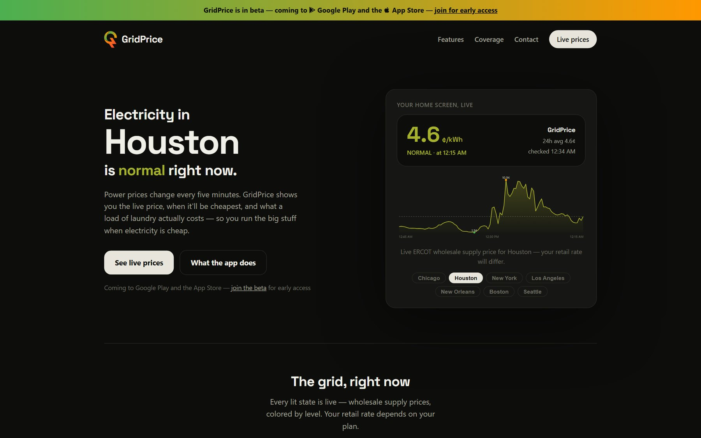
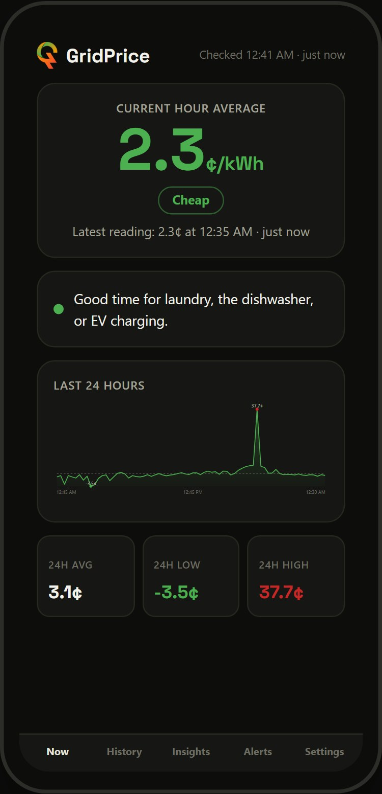
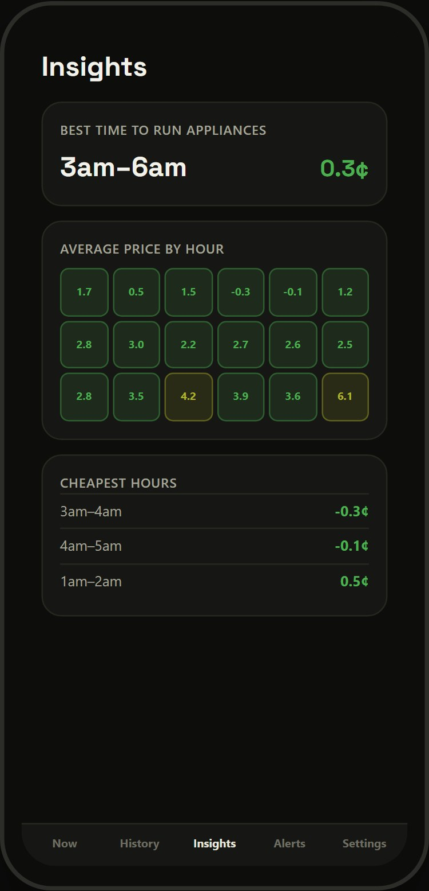
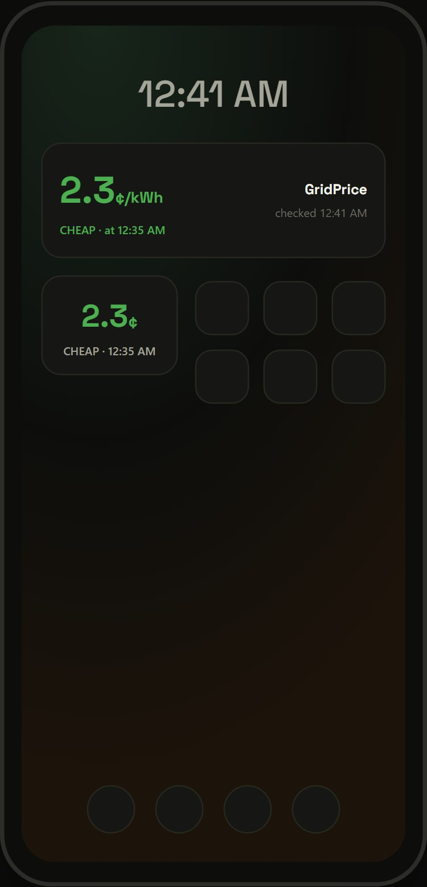
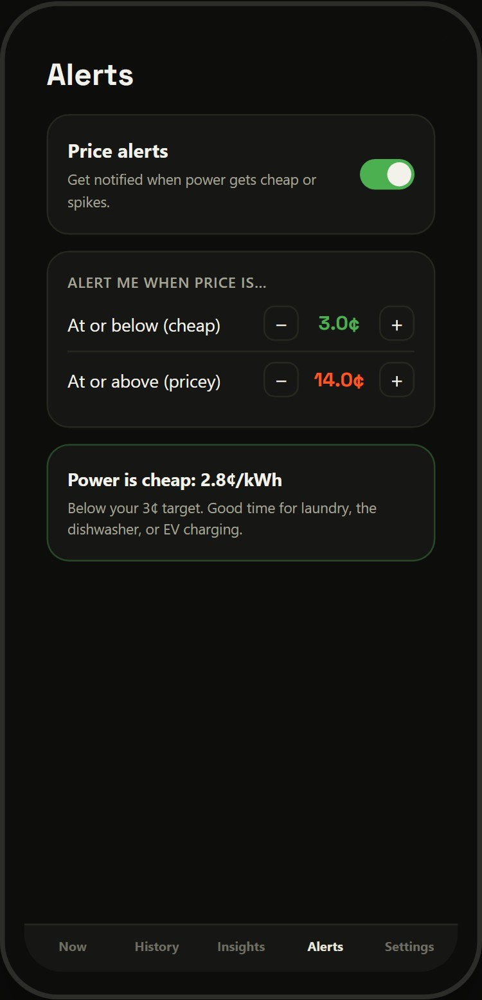
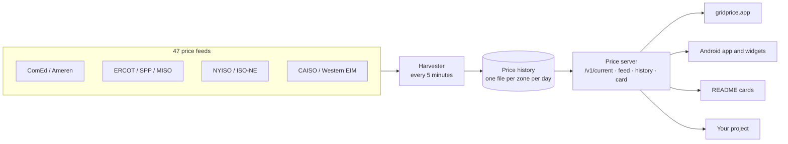

<h1 align="center">GridPrice</h1>

<p align="center"><b>What electricity costs right now, and when it will be cheapest.</b><br>
Live hourly prices for 33 states, a free public API, and an Android app with widgets and alerts.</p>

<p align="center">
  <a href="https://gridprice.app">Website</a> ·
  <a href="https://gridprice.app/live.html">Live prices</a> ·
  <a href="https://gridprice.app/api.html">API docs</a> ·
  <a href="https://gridprice.app/#beta">Join the app beta</a>
</p>

<p align="center">
  <a href="https://gridprice.app">
    <picture>
      <source media="(prefers-color-scheme: light)" srcset="https://gridprice.app/v1/card/chicago.svg?theme=light">
      
    </picture>
  </a>
</p>

<p align="center"><sub>That card is not a screenshot. It is drawn by the GridPrice server from the latest price and refreshes every five minutes.</sub></p>

---

## Why GridPrice

More and more people pay for electricity by the hour. ComEd and Ameren customers in Illinois can sign up for hourly pricing, much of Texas buys power on prices that follow ERCOT, and anyone with an EV, a home battery or a smart thermostat can save real money by moving usage to the cheap hours.

The catch is that the price changes every five minutes and nobody tells you what it is. On a hot afternoon it can be ten times what it was at 4 a.m. The same load of laundry, the same EV charge, the same hour of air conditioning can cost wildly different amounts depending on when you start it.

GridPrice puts that number in front of you:

- **The live price**, colour-coded from Cheap to Very high, with the last 24 hours behind it.
- **The cheapest window today**, so you know when to start the dishwasher or plug in the car.
- **Alerts** when the price drops below a floor you pick or spikes above a ceiling.
- **Home-screen widgets** that refresh every five minutes, so you never have to open anything.
- **Tomorrow's prices** for Illinois hourly pricing, published each evening.
- **A cost estimator** that turns cents per kWh into dollars: an EV charge, a dryer load, an hour of AC.

It is free, there is no account, and the data behind it is open to anyone through the API.

## Who it's for

| If you... | GridPrice helps you... |
|---|---|
| **Drive an EV** | Charge in the cheapest hours of the night instead of the minute you get home. |
| **Are on ComEd or Ameren hourly pricing** | See today's price, tomorrow's curve, and get a push before a price spike. |
| **Live in Texas** | Watch ERCOT prices for your load zone during heat waves and cold snaps, when they move the most. |
| **Have solar or a home battery** | Decide when to charge, when to discharge, and when to export. |
| **Run a pool pump, water heater or anything on a timer** | Move it to the cheap window and leave it there. |
| **Use Home Assistant or build smart-home automations** | Pull the live price from the API and let your house react to it. |
| **Write code, study energy, or are just curious** | Get clean, consistent prices for 47 grid zones with history going back months. |

## See it

<p align="center">
  
</p>

<p align="center">
  
  
  
  
</p>

<p align="center"><sub>The website, and the Android app's Now, Insights, Widgets and Alerts screens.</sub></p>

## Live price cards

Every city GridPrice covers has a card like the one at the top of this page. They are plain SVG images served straight from the price server, so they work anywhere an image works: a GitHub README, a blog post, a Notion page, a wiki, a dashboard.

These are live right now:

<table>
  <tr>
    <td></td>
    <td></td>
  </tr>
  <tr>
    <td></td>
    <td></td>
  </tr>
  <tr>
    <td></td>
    <td></td>
  </tr>
</table>

Each card shows the current price and its level, how it compares with the 24-hour average, a sparkline of the last day, and when it was last updated in that city's own time zone.

### Put one on your own page

One line of Markdown:

```markdown
[](https://gridprice.app)
```

Add `?theme=light` to the image URL for a white card on light pages. Every option is in [docs/cards.md](docs/cards.md).

**Cities:** `chicago`, `houston`, `dallas`, `austin`, `san-antonio`, `new-york`, `long-island`, `buffalo`, `albany`, `los-angeles`, `san-diego`, `san-francisco`, `boston`, `hartford`, `providence`, `seattle`, `portland`, `phoenix`, `las-vegas`, `salt-lake-city`, `boise`, `albuquerque`, `minneapolis`, `milwaukee`, `des-moines`, `detroit`, `indianapolis`, `st-louis`, `new-orleans`, `oklahoma-city`, `kansas-city`, `omaha`.

Any provider id from the API works too, for example `/v1/card/ercot-lz_west.svg`. Add `?theme=light` for the light version.

## The API

Everything GridPrice shows comes from four public endpoints. The website, the live map, the Android app and its widgets all use exactly the same API you can.

- **Free, no key, no sign-up.**
- **CORS is open**, so you can call it straight from a browser.
- **Prices are in cents per kWh.** Times are `ms`, the UTC epoch in milliseconds of the start of the interval.
- **Updated every five minutes.**

| Endpoint | Returns |
|---|---|
| `GET /v1/providers` | Every provider id GridPrice covers |
| `GET /v1/current?provider=comed` | The latest price |
| `GET /v1/feed?provider=comed` | Roughly the last 24 hours of prices |
| `GET /v1/history?provider=comed&start=20260901&end=20260930` | Every price between two dates (`YYYYMMDD`, inclusive) |
| `GET /v1/card/<city>.svg` | The live price card described above |

### Examples

Request:

```
https://gridprice.app/v1/current?provider=comed
```

Response:

```json
{ "ms": 1791430500000, "price": 14.7 }
```

Request:

```
https://gridprice.app/v1/feed?provider=ercot-lz_houston
```

Response, oldest first:

```json
[
  { "ms": 1791345600000, "price": 4.309 },
  { "ms": 1791346500000, "price": 4.451 }
]
```

Full reference: [docs/api.md](docs/api.md), also on the website at [gridprice.app/api.html](https://gridprice.app/api.html).

## Coverage

47 price feeds across 33 states.

| Grid operator | Region | Provider ids |
|---|---|---|
| **ComEd** | Northern Illinois, hourly pricing | `comed` |
| **Ameren Illinois** | Central and southern Illinois, hourly pricing | `ameren-il` |
| **ERCOT** | Texas load zones | `ercot-lz_houston`, `ercot-lz_north`, `ercot-lz_south`, `ercot-lz_west`, `ercot-lz_aen`, `ercot-lz_cps` |
| **NYISO** | New York zones | `nyiso-nyc`, `nyiso-longil`, `nyiso-hudvl`, `nyiso-capitl`, `nyiso-centrl`, `nyiso-west` |
| **ISO-NE** | New England states | `isone-ma`, `isone-ct`, `isone-ri`, `isone-nh`, `isone-vt`, `isone-me` |
| **MISO** | Upper Midwest to the Gulf | `miso-mn`, `miso-wi`, `miso-ia`, `miso-mi`, `miso-in`, `miso-mo`, `miso-ar`, `miso-la`, `miso-ms` |
| **SPP** | Central plains | `spp-ok`, `spp-ks`, `spp-ne`, `spp-sd`, `spp-nd` |
| **CAISO** | California | `caiso-np15`, `caiso-sp15` |
| **Western EIM** | Pacific Northwest and Mountain West | `eim-pge`, `eim-pacw`, `eim-psei`, `eim-nevp`, `eim-azps`, `eim-ipco`, `eim-pace`, `eim-pace-ut`, `eim-pace-wy`, `eim-nwmt`, `eim-pnm` |

These are the supply prices that change through the day: ComEd and Ameren's hourly rates, and the grid operators' real-time wholesale prices elsewhere. Your bill adds delivery charges and fees on top, but those stay the same whatever the hour, so this is the number that tells you when to use power.

## How it works



**One server, no dependencies.** The website and the API are a single Node.js process built on the standard library alone: no framework, no database, no build step. It runs unattended in a Docker container on a self-hosted machine, behind Caddy and a Cloudflare Tunnel. Nothing to update, and nothing to break on `npm install`.

**A harvester every five minutes.** Each grid operator publishes prices its own way: JSON, CSV downloads, zipped archives, HTML pages. The harvester pulls all 47 feeds, turns every reading into the same `{ ms, price }` shape, and merges it into one file per zone per day. Merging by interval means a feed can be read early, late or twice without ever duplicating a point.

**History that outlasts the source.** Several operators only keep a short window of data, and NYISO deletes after about two weeks. GridPrice has kept every price since it started, so `/v1/history` can answer for any date range.

**Fetched once, for everyone.** Some feeds refuse requests from phones and browsers outright. Fetching them on the server makes them available everywhere, and means each feed is read once every five minutes instead of once per user.

**Time zones done carefully.** Every operator publishes in its own local time and handles the daylight-saving changeover differently. Times are resolved to UTC with the built-in `Intl` APIs, and the hour that repeats each November is handled explicitly.

**Cards drawn on the server.** Each card is built from the cached feed: the level, the comparison with the 24-hour average, and the sparkline are all computed and written out as a self-contained SVG with no scripts, fonts or images, which is what lets it render through GitHub's image proxy. A card is cached for five minutes, one price interval.

### Where it started

Version 1 was a Kotlin Android app for ComEd only, and every phone fetched the price for itself. Version 2 put one price server behind everything, which turned the app, the website and the cards into views over the same four endpoints and made it possible to grow from one utility to 33 states.

## Status

- **Website and API:** live at [gridprice.app](https://gridprice.app).
- **Android app:** in beta, heading to Google Play. [Join the beta](https://gridprice.app/#beta).
- **iOS:** planned.

## Documentation

| Page | What's in it |
|---|---|
| [API reference](docs/api.md) | Every endpoint, parameter, response, error, caching rule and price level |
| [Live price cards](docs/cards.md) | Embed a self-updating price image in a README, blog or dashboard |
| [Coverage](docs/coverage.md) | All 47 feeds, the 33 states, update intervals, and what the prices mean |
| [How it works](docs/how-it-works.md) | The server, the harvester, history, time zones, the cards and the app |
| [FAQ](docs/faq.md) | Pricing, coverage, the app, the API and the source code |

## About this repository

This is the public home of GridPrice: what it does, how it works, the API and the live cards. GridPrice is a product I'm still building, so the server and app source code are private. The API is open for anyone to use.

Found a problem with a price feed, or want a city or utility added? [Open an issue](../../issues).

Built by [James Patton](https://jamesclaypatton.com).

<sub>© 2026 James Patton. All rights reserved. Price data comes from the utilities and grid operators named above.</sub>
