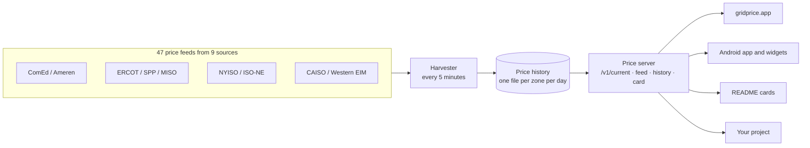

# How it works

GridPrice is one small server that does four things: it collects electricity prices from nine grid operators every five minutes, stores every one of them forever, serves them through a public API, and draws them as a website, an app and live images. This page explains each part and the decisions behind it.



## The server

The website and the API are one Node.js process written against the standard library alone: `http`, `fs`, `path` and the built-in `Intl` date APIs. There is no web framework, no database and no build step, and `package.json` has no runtime dependencies.

That is a deliberate choice for something that has to run unattended for months. There is nothing to update, nothing that can break on `npm install`.

It runs in a Docker container on a self-hosted machine. Caddy sits in front of it, and a Cloudflare Tunnel carries traffic in from the internet, so no ports are open on the home network and TLS is handled at Cloudflare's edge.

## The harvester

Every five minutes the server fetches all 47 feeds at once.

The hard part is that electricity prices are not published as a tidy API. Depending on the operator, a price arrives as JSON, a CSV download, a zipped archive of CSVs, or a table in an HTML page, each with its own idea of what a timestamp means and its own units. One fetcher per source turns all of that into the same shape:

```json
{ "ms": 1791430500000, "price": 4.3 }
```

`ms` is the start of the interval as a UTC timestamp and `price` is in cents per kWh, converted from dollars per MWh where needed.

Each reading is merged into a file for that zone and that day, keyed by interval. Merging by interval means a feed can be read early, late, twice, or can return overlapping windows, and the stored history never gains a duplicate point. A failed fetch is logged and simply tried again five minutes later; one operator having a bad day never affects the others.

## Fetching on the server

Some operators block requests that come from phones or browsers, or have no CORS headers at all. Version 1 of the app fetched ComEd directly from every phone, which worked for one utility and would not have worked for nine.

Fetching on the server fixes both problems. Every feed becomes available to every client, and each operator sees one request every five minutes instead of one per user.

## History

Several operators only keep a short window of their own data online. NYISO's real-time prices disappear after about two weeks. GridPrice has stored every reading since July 22, 2026, so `/v1/history` can answer for any range since then, long after the source has deleted it.

Storage is plain JSON files, one per zone per day. They are small, easy to back up, and need no database.

## Time zones

Each grid operator publishes in its own local time: Central for ComEd and ERCOT, Eastern for NYISO and ISO-NE, Pacific for CAISO, and so on. Each also handles the daylight-saving changeover in its own way.

GridPrice converts every local time to UTC as it arrives, using the time-zone database built into Node through `Intl.DateTimeFormat`, with no time-zone library. The hour that happens twice each November, when clocks go back, is resolved explicitly so the two 1 a.m. intervals land an hour apart instead of on top of each other.

History is organised by the operator's local calendar day, because that is how people think about it: "yesterday in New York" means midnight to midnight Eastern time.

## The API

Four JSON endpoints and one image endpoint, all described in the [API reference](api.md). Everything GridPrice shows is built on them:

- **The website** draws its price card, chart and live map from `/v1/current` and `/v1/feed`.
- **The Android app** uses the same calls for its screens, and its widgets refresh every five minutes from `/v1/current`.
- **The cards** are rendered from the same cached feed.

Building the app and the website on the public API, instead of on private endpoints, keeps the API honest: if something is missing from it, GridPrice itself notices first.

## The cards

A card is computed and written as an SVG string on the server: the price and level, the comparison with the 24-hour average, the sparkline path, and the update time in the city's own time zone. The renderer turns a list of prices into SVG text and nothing else, which makes it easy to test.

Three constraints shaped it:

- **No scripts, fonts or external images.** GitHub serves README images through its own proxy and strips anything active, so the SVG has to be complete and static.
- **Never a broken image.** An unknown city or a dead feed still gets a valid card saying so.
- **Fresh, but not hammered.** Cards are cached for five minutes, one price interval, on both the server and in GitHub's proxy, and marked `private` so Cloudflare does not hold an old one for hours.

See [live price cards](cards.md).

## The app

The Android app started as version 1: Kotlin, Retrofit for the network calls, WorkManager for background refresh and MPAndroidChart for the graphs, covering ComEd only.

Version 2 was rebuilt around the central API. With one server doing the fetching, the app became a set of views over the same endpoints: the Now screen, Insights (the cheapest three-hour window and an hour-by-hour heatmap), history, alerts, and home-screen widgets in two sizes.

## Lessons

- **Most of the work is in the fetchers.** Serving prices is the easy part; dealing with every operator's formats, outages and quirks is where the time goes.
- **No dependencies was the right call** for a server that has to keep running for months without attention.
- **Keep the raw data.** Storing every reading from day one made the history endpoint possible, and that data cannot be fetched again once the operators delete it.
- **Build the product on the public API.** It meant the API was finished, documented and tested before anyone outside used it.
